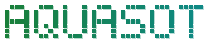

<div align="center">

<picture>
  <source media="(prefers-color-scheme: dark)" srcset=".github/assets/banner-dark.svg">
  <source media="(prefers-color-scheme: light)" srcset=".github/assets/banner-light.svg">
  
</picture>

<p><b>End-to-end RGB-Sonar single object tracking for underwater environments</b></p>

<p>
  <a href="LICENSE"></a>
  <a href="https://www.python.org/downloads/"></a>
  <a href="https://pytorch.org/"></a>
  <a href="https://agents.md"></a>
  <a href="https://agentskills.io"></a>
  <!-- Reserved badges: uncomment when the service exists.
  <a href="https://github.com/rohanhong/AquaSOT/actions/workflows/<workflow>">?branch=main"></a>
  <a href="https://github.com/rohanhong/AquaSOT/releases"></a>
  -->
  <a href="https://github.com/rohanhong/AquaSOT/commits/main"></a>
  <a href="https://github.com/rohanhong/AquaSOT/stargazers"></a>
</p>

<p>🌐 <b>English</b> | <a href="docs/i18n/README.zh-CN.md">简体中文</a></p>

</div>

AquaSOT is an end-to-end multi-modal single object tracking framework that fuses RGB camera and Forward-Looking Sonar (FLS) data without requiring extrinsic calibration. The system employs a dual-stream Vision Transformer architecture with Deformable Cross-Modal Attention (DCMA) for calibration-free correspondence learning.

## ✨ Highlights

- 🧠 **Dual-stream ViT**: separate ViT-Base backbones for RGB (3-ch) and Sonar (1-ch) feature extraction.
- 🔗 **Calibration-free fusion**: Deformable Cross-Modal Attention aligns the two modalities spatially without extrinsic calibration.
- 🎯 **Modality-specific heads**: separate prediction heads for RGB and Sonar, so the asymmetric fields of view do not cause prediction drift.
- 🔬 **Built-in ablations**: inference-time `rgb_only`, `sonar_only`, and `no_fusion` modes with BatchNorm adaptation.

## 🏗️ Architecture

```
RGB Input   --> ViT Backbone --+
                               +--> DCMA Fusion --> Prediction Heads --> BBox (RGB, Sonar)
Sonar Input --> ViT Backbone --+
```

## 🚀 Quick Start

> [!NOTE]
> Requires conda (for example [Miniforge](https://conda-forge.org/download/)) and a CUDA 11.8 capable GPU. `environment.yml` creates the `aquasot_env_py38` env (Python 3.8) and installs `requirements.txt` into it; without conda, `pip install -r requirements.txt` works in any Python 3.8+ env. The dataset and training outputs are not part of this repository: download the RGBS50 sequences from their official release and place them under `data/` as shown in [Dataset](#-dataset). Step 3 is for maintainers only: it fetches pinned copies from private Hugging Face repos (access required).

1. Clone the repository and install:

   ```bash
   git clone https://github.com/rohanhong/AquaSOT.git
   cd AquaSOT
   conda env create -f environment.yml
   conda activate aquasot_env_py38
   pip install -e .
   ```

2. Download the MAE pretrained weights:

   ```bash
   wget -O models/pretrained/mae_pretrain_vit_base.pth \
       https://dl.fbaipublicfiles.com/mae/pretrain/mae_pretrain_vit_base.pth
   ```

3. Maintainers only: fetch the pinned dataset and training outputs from Hugging Face (log in once first):

   ```bash
   hf auth login
   python scripts/fetch_artifacts.py
   ```

4. Only for raw data: convert sonar frames from polar to Cartesian coordinates (once; fetched data already includes `img_rect/`):

   ```bash
   python scripts/preprocess_sonar.py --all
   ```

5. Train, then evaluate:

   ```bash
   python tracking/train.py --script aquasot --config vitb_256_dual
   python tracking/test.py --tracker aquasot --checkpoint outputs/train/checkpoints/model.pth
   ```

## 📦 Dataset

AquaSOT trains and evaluates on 12 UUV sequences (`uuv1` to `uuv12`) with paired RGB-Sonar frames, taken from the **RGBS50** RGB-Sonar tracking benchmark by Li et al. ([arXiv:2406.07189](https://arxiv.org/abs/2406.07189)). RGBS50 is published by its authors at [LiYunfengLYF/RGBS50](https://github.com/LiYunfengLYF/RGBS50), whose README links the download ([Baiduyun](https://pan.baidu.com/s/1mC192X-NnH4ByMxvVtYtvg?pwd=orrx), password `orrx`). This repository does not redistribute the data; if you use it, cite RGBS50 (see [Citation](#-citation)). Expected layout:

```
data/
  uuv1/                    # Training
    light/                 # RGB: img/, groundtruth.txt
    sonar/                 # Sonar: img_rect/, groundtruth_rect.txt
  uuv2/ ... uuv12/
```

**Split:** Training (uuv1,2,4,5,6,7,8,9,10,11,12) | Validation (uuv3)

For maintainers, `scripts/fetch_artifacts.py` downloads the copies pinned in `scripts/hf_artifacts.yaml`: the dataset from the private dataset repo `aquasot/aquasot-data` (one tar per sequence, checked against its sha256 and extracted into `data/`), and the training outputs, including the paper checkpoint `outputs/train/aquasot/vitb_256_dual_auto/checkpoints/checkpoint_ep0100.pth`, from the private model repo `aquasot/aquasot-models` into `outputs/`. `python scripts/fetch_artifacts.py --verify_only` checks local copies without downloading; if a transfer stalls, rerun with `HF_HUB_DISABLE_XET=1`.

## 🏋️ Training

```bash
# Standard training
python tracking/train.py --script aquasot --config vitb_256_dual

# With W&B logging
python tracking/train.py --script aquasot --config vitb_256_dual --wandb
```

Configuration files are located in `experiments/aquasot/`. `scripts/auto_config.py` derives a hardware-tuned `vitb_256_dual_auto.yaml`; see [docs/TRAINING.md](docs/TRAINING.md).

## 📊 Evaluation

```bash
# Standard dual-modal evaluation
python tracking/test.py \
    --tracker aquasot \
    --checkpoint outputs/train/checkpoints/model.pth \
    --dataset aquasot \
    --dataset_path data/

# Ablation studies (inference-time, requires --bn_adapt)
python tracking/test.py --checkpoint model.pth --eval_mode rgb_only --bn_adapt
python tracking/test.py --checkpoint model.pth --eval_mode sonar_only --bn_adapt
python tracking/test.py --checkpoint model.pth --eval_mode no_fusion --bn_adapt

# Disable visibility filtering (include absent frames)
python tracking/test.py --checkpoint model.pth --no_filter_visibility
```

<details>
<summary>Evaluation options</summary>

- `--eval_mode {dual,rgb_only,sonar_only,no_fusion}`: Evaluation modality mode
- `--bn_adapt`: Enable BatchNorm adaptation (required for ablation studies)
- `--no_filter_visibility`: Include all frames (ignore GT absence)
- `--no_skip_init_frame`: Include frame 0 in evaluation
- `--plot_curves`: Generate success/precision curve plots

</details>

**Metrics:** Success (AUC), Precision@20, Center Error (per modality)

## 🗂️ Project Structure

| Path | Contents |
|---|---|
| `lib/models/aquasot/` | Model: backbone, fusion, head |
| `lib/train/` | Training: dataset, actor, trainer |
| `lib/test/` | Evaluation: tracker, metrics |
| `lib/config/` | Default configuration |
| `tracking/` | Entry points: `train.py`, `test.py` |
| `experiments/aquasot/` | YAML configurations |
| `scripts/` | Utility scripts |
| `data/` | Dataset directory |

## 📝 Citation

```bibtex
@mastersthesis{hong2026aquasot,
  title={{AquaSOT}: End-to-End Dual-Modal Single Object Tracking in Underwater Environments},
  author={Hong, Luhang},
  school={Nanyang Technological University},
  address={Singapore},
  type={Master's dissertation},
  year={2026},
  url={https://hdl.handle.net/10356/213865}
}
```

If you use the dataset, also cite RGBS50:

```bibtex
@article{li2024rgbs50,
  title={{RGB}-Sonar Tracking Benchmark and Spatial Cross-Attention Transformer Tracker},
  author={Li, Yunfeng and Wang, Bo and Sun, Jiuran and Wu, Xueyi and Li, Ye},
  journal={arXiv preprint arXiv:2406.07189},
  year={2024}
}
```

## 📚 Documentation

| Document | Contents |
|---|---|
| [docs/TRAINING.md](docs/TRAINING.md) | Prerequisites, auto-configuration, training, monitoring |
| [docs/TESTING.md](docs/TESTING.md) | Evaluation commands and outputs |
| [docs/ABLATION.md](docs/ABLATION.md) | Ablation experiments |
| [docs/specs/](docs/specs/) | Method, mathematical formulation, dataset specification |
| [AGENTS.md](AGENTS.md) | Instructions for AI coding agents |

## 🤝 Contributing

Contributions are welcome. Read the [contributing guide](CONTRIBUTING.md) before opening an issue or pull request.

## 🔗 Resources

- **OSTrack** (ECCV 2022): [Joint Feature Learning and Relation Modeling for Tracking](https://arxiv.org/abs/2203.11991)
- **RGBS50** (2024): [RGB-Sonar Tracking Benchmark](https://arxiv.org/abs/2406.07189)
- **Deformable DETR** (ICLR 2021): [Deformable Transformers for Object Detection](https://arxiv.org/abs/2010.04159)

## ⚖️ Legal

- License: [MIT](LICENSE)
- Third-party notices: [THIRD_PARTY_NOTICES.md](THIRD_PARTY_NOTICES.md)
- Code of Conduct: [Contributor Covenant 3.0](CODE_OF_CONDUCT.md)
- Security: [Security Policy](SECURITY.md)

## ⭐ Star History

<a href="https://www.star-history.com/#rohanhong/AquaSOT&Date">
  <picture>
    <source media="(prefers-color-scheme: dark)" srcset="https://api.star-history.com/svg?repos=rohanhong/AquaSOT&type=Date&theme=dark">
    <source media="(prefers-color-scheme: light)" srcset="https://api.star-history.com/svg?repos=rohanhong/AquaSOT&type=Date">
    
  </picture>
</a>
